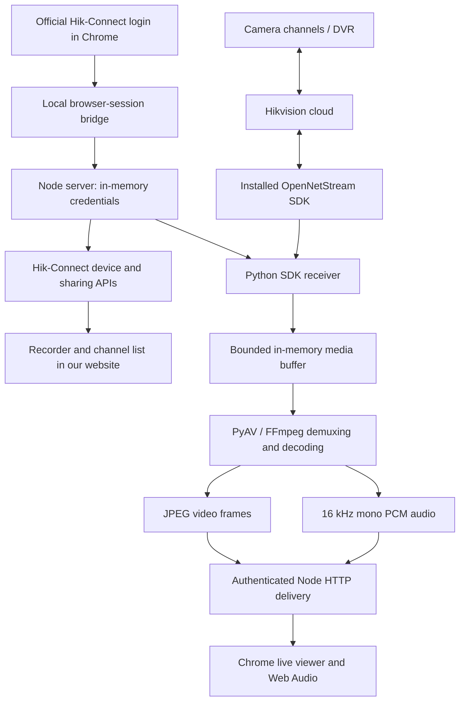

# Hikvision integration: the complete learning guide

Written from our project investigation and discussion on 22–23 October 2026.

This guide combines the detailed explanations from the recent conversation: the overall integration, the investigation of iVMS-4200, the useful failed experiments, the working video pipeline, the audio implementation, and the next requirement for an independent product login.

No passwords, account tokens, SDK callback credentials, or camera encryption keys are included. Example identifiers are placeholders unless they are recorder names already used in the project.

## 1. What we actually achieved

The central discovery was that **getting a device list and getting its video are separate problems**.

The personal Hik-Connect website exposed account, recorder, sharing, and channel information. The installed iVMS client supplied a streaming SDK that could establish an authorized playback connection. We built a local bridge between that SDK and the browser.

We did not obtain a permanent public MP4 URL. We did not rewrite Hikvision’s entire cloud protocol, bypass its account permissions, or capture screenshots from the iVMS window. We received actual media through its installed SDK and decoded that media ourselves.

### Verified results

- Real account and shared-recorder discovery.
- Five shared recorders containing 48 shared camera channels.
- KPM 5 reporting Online when the owner brought it online.
- KPM 5 video playing in the official phone app and iVMS, as confirmed by the user.
- A separate Python process authenticating to the installed SDK and receiving camera media.
- H.265 video decoding in that separate process.
- Video rendering in our custom website.
- Main/substream selection, presented as HD/SD.
- Camera-channel switching and Stop.
- The user’s confirmation that video worked in the custom website.

### Implemented but not yet verified against a live camera

Audio decoding and browser mute/unmute are implemented. Generated-audio tests and a real Chrome Web Audio scheduling test passed. All recorders were Offline during that change, so actual camera sound through our website still requires a live test.

### Still a prototype limitation

The application currently imports an existing signed-in browser session and, when available, the SDK authorization result. It does not yet implement independent production account login, durable credential storage, token renewal, or deployment for access from arbitrary laptops.

## 2. Break the requirement into independent layers

The user-facing request was:

> Show cameras shared with my Hik-Connect account inside my own website.

That request contains several technical layers:

| Layer | Question to answer |
|---|---|
| Authentication | Which user has signed in, and what credential authorizes requests? |
| Recorder discovery | Which devices are owned by or shared with that user? |
| Channel discovery | Which camera channels inside each recorder are accessible? |
| Playback authorization | Does the playback service allow this credential to open this channel? |
| Transport | How do the media bytes reach our process? |
| Packaging | How are video/audio packets framed or placed inside a container? |
| Decoding | How do compressed packets become image frames and sound samples? |
| Browser delivery | How do we send those results to Chrome? |
| Lifecycle | How do start, stop, switching, disconnects, and failures release resources? |

A successful device-list request proves only part of this chain. Likewise, a visible Live View permission does not prove that the current webpage contains a usable player.

The investigation progressed by proving one layer at a time.

## 3. The architecture we built



The PC running the local server performs the native SDK connection and H.265 decoding. Chrome receives browser-compatible images and PCM audio rather than directly participating in the vendor’s original transport.

## 4. Starting with the signed-in browser

Instead of first rebuilding password encryption, CAPTCHA handling, login-region selection, and additional verification, we used the account session the user had already established in Chrome.

The official personal portal exposed a session cookie named:

```text
HC_sessionId
```

It also stored descriptive account information under:

```text
hik_connect_user
```

These have different purposes:

```text
Session credential → authorizes requests.
Account metadata   → describes the user and account region.
```

An email address or username alone does not authorize a device request.

The local Node server imports the session and retains it in memory. The custom webpage receives a separate opaque HttpOnly cookie for the local workspace. It does not need Hikvision’s cloud token in its JavaScript.

This let us investigate the real APIs before building a complete authentication product. It was a development shortcut, not a finished login solution.

Implementation: [lib/browser-session.mjs](lib/browser-session.mjs).

## 5. How connecting to Chrome worked

There are two separate connections:

```text
Webpage → local Node server
Local Node server → Chrome debugging interface
```

They can fail independently. A stopped local server can produce “Failed to fetch.” A running server that cannot reach Chrome can return a debugging-connection error. A successful Chrome connection can still find no signed-in Hik-Connect session.

### Conventional tab discovery

Many Chrome debugging configurations expose:

```text
http://127.0.0.1:9222/json/list
```

That endpoint lists tabs and their debugging WebSocket addresses.

### The alternative required by this Chrome setup

In this investigation, the discovery endpoint sometimes returned HTTP 404 while a browser debugging WebSocket was available.

We added discovery through Chrome’s `DevToolsActivePort` file. That file supplies the port and browser WebSocket path. It is endpoint metadata; reading it is not reading Chrome’s saved-password database.

The connection then used Chrome DevTools Protocol operations:

```text
Target.getTargets
Target.attachToTarget
Runtime.evaluate
Target.detachFromTarget
```

Their roles were:

1. List available browser targets.
2. Select the official Hik-Connect tab.
3. Attach to that target.
4. Evaluate a small fixed session-inspection script.
5. Detach after reading the relevant information.

The application recognizes the observed official hosts and signed-in portal paths. It does not treat a lookalike hostname as valid.

The debugging connection supplies inspection access to Chrome. Camera permissions still come from the Hik-Connect account.

## 6. Discover APIs by observing real UI actions

The useful question was not “What API name sounds plausible?” It was:

> What request does the official application make when I open this particular screen?

Observed personal-device routes included:

```http
GET /v3/hcweb/devices/list?limit=10&offset=0
GET /v3/hcweb/share/domains
```

Those routes serve different categories:

```text
Account
├── Devices owned by the account
└── Devices shared with the account
```

The owned-device list was empty. That was a successful empty result, not automatically an authentication failure.

Initially, the shared-device list was empty too. After the user arranged the sharing, it returned five recorder records.

### Manual technique

1. Open Chrome DevTools on the official portal.
2. Open Network and filter to Fetch/XHR.
3. Clear old requests if necessary.
4. Perform exactly one UI action.
5. Identify the new request associated with that action.
6. Examine its method, path, request encoding, response shape, and result code.
7. Repeat the action if needed to confirm the association.

Keep account credentials and raw authenticated requests private. For learning notes, record routes, field names, safe examples, and result codes rather than complete live credentials.

## 7. Regional routing matters

The working personal account used:

```text
https://iindia.hik-connect.com
```

The initial entry point was:

```text
https://www.hik-connect.com
```

A hostname can identify the regional infrastructure serving the account. It is part of the connection configuration, not just branding.

We therefore retained both the account session and the observed account origin. Requests were sent to that regional origin rather than blindly using the global hostname.

We also observed two signed-in portal layouts:

```text
/views/main/...
/views/login/index.html#/portal
```

The second route can contain the authenticated application despite “login” appearing in its pathname. The bridge was updated to recognize that specific signed-in route, while still rejecting the ordinary login screen as a device portal.

## 8. From shared recorders to camera channels

A share-list record supplied recorder-level information, roughly:

```json
{
  "shareId": "example-share",
  "devDomain": "example-recorder",
  "subSerial": "example-serial",
  "status": 2
}
```

That did not yet describe the cameras inside the recorder.

We opened Sharing details in the official UI and observed:

```http
POST /v3/hcweb/share/accept/device
Content-Type: application/x-www-form-urlencoded
```

The form body contained:

```text
deviceId=<share identifier>
```

Although the path includes the word `accept`, this was the request observed while opening the details of an existing share. We reproduced that observed read operation; we did not assume that its name described a new ownership change.

The request body was form encoded, not JSON. These are different encodings:

```text
deviceId=example-share
```

```json
{"deviceId":"example-share"}
```

The details response contained a recorder name and `shareCameras`:

```json
{
  "shareDevice": {
    "devName": "KPM 5",
    "shareCameras": [
      {"channelNo": 1, "cameraName": "Camera 01"},
      {"channelNo": 2, "cameraName": "Camera 02"}
    ]
  }
}
```

The observed totals were:

| Recorder | Shared channels |
|---|---:|
| KPM 5 | 8 |
| KPM Bus 4 | 8 |
| KPM 3 | 8 |
| KPM 2 | 16 |
| KPM 1 | 8 |
| Total | 48 |

These came from share details, rather than assumptions about the recorder model or its maximum channel capacity.

Implementation: [lib/hik-connect.mjs](lib/hik-connect.mjs).

## 9. Establish online status before testing playback

We compared API status values with the visible official interface:

```text
Observed status 2 → Offline
Observed status 1 → Online
```

Other values remain unknown unless verified.

At first, all five recorders were Offline. That still allowed metadata investigation, but not an honest live-stream test.

When KPM 5 came online, the user confirmed live video in the phone app and iVMS. That created a working reference operation.

An offline device, an unauthorized request, a failed transport, and a decoder failure are different problems. Diagnose them separately.

## 10. Why we investigated iVMS

The personal-device portal exposed management and sharing information but did not provide a working player for these shared cameras in the context we inspected. Another web video interface displayed no cameras for that context.

Continuing to search only for an HTML video element or a downloadable MP4 URL was not a sufficiently supported approach.

The desktop client could already play the camera. The productive question became:

> Which component inside the installed client performs the authorized streaming operation?

We did not need to begin by decompiling the mobile application. The desktop installation offered accessible files, logs, process information, and an SDK.

## 11. The working-reference technique

Before investigating a complicated application, define one operation that definitely works:

```text
Application: iVMS-4200
Recorder: KPM 5
Channel: Camera 01
Action: Start live view
Result: Moving video appears
```

This fixes several variables: PC, installation, account, permissions, recorder, and channel.

Without a known-good reference, a failed experiment could mean an offline device, wrong account, missing permission, unsupported client, wrong region, or incorrect code.

The investigation then asks how to reproduce that one operation. Reproducing the whole application is unnecessary.

## 12. Process inspection: find the component doing the work

The visible window is not necessarily the process performing the stream connection. Desktop products often consist of separate framework, device-management, alarm, and video processes.

We used PowerShell:

```powershell
Get-Process |
    Where-Object { $_.ProcessName -match '^iVMS' } |
    Select-Object ProcessName, Id
```

Names observed included:

```text
iVMS-4200.Framework.C
iVMS-4200.Framework.S
iVMS-4200.DeviceManagement.S
iVMS-4200.Video.C
```

A name is a clue, not proof. Compare process activity before playback, during playback, and after Stop.

This is differential observation: change one variable and look for corresponding changes.

## 13. Associate network connections with process IDs

Windows can report which process owns a TCP socket.

```powershell
$ivmsProcesses = @(
    Get-Process |
        Where-Object { $_.ProcessName -match '^iVMS' }
)
$ivmsIds = @($ivmsProcesses.Id)

Get-NetTCPConnection |
    Where-Object {
        $_.OwningProcess -in $ivmsIds -and
        $_.State -eq 'Established'
    } |
    Select-Object OwningProcess, LocalAddress, LocalPort,
                  RemoteAddress, RemotePort |
    Format-Table -AutoSize
```

While playback was active, the video process had established cloud TCP connections on port 7100.

That established remote communication associated with the playing process. It did not identify a permanent video URL or prove which individual socket carried media.

A socket address does not describe the application protocol, required login exchange, encryption, packet framing, or decoding rules.

For a stronger manual experiment, compare the connection list before playback, during playback, and after Stop. Connections that track the operation are useful candidates for further investigation.

## 14. Inspect installed components

The installation was under a directory shaped like:

```text
C:\Program Files (x86)\iVMS-4200 Site\
```

We searched relevant filenames:

```powershell
rg --files "C:\Program Files (x86)\iVMS-4200 Site" |
    rg '(?i)(OpenNetStream|HCNetSDK|PlayCtrl|StreamClient)'
```

The results included:

```text
OpenNetStream.dll
HCNetSDK.dll
PlayCtrl.dll
StreamTransClient.dll
```

A DLL is a compiled library. A larger application can delegate specialized work to it:

```text
iVMS interface → streaming library → cloud connection/media
```

The filename suggested where to look. Exported functions and runtime logs supplied stronger evidence.

## 15. DLL export inspection

A Windows DLL can expose callable functions through its export table. An exported name identifies an entry point in the compiled library.

We read the DLL’s PE-format export table using a small Python script. Conceptually, the script:

1. Read the DLL file.
2. Found the PE header.
3. Located the export directory.
4. Read the exported function names.
5. Printed those names.

This was static inspection. It did not execute those functions or require decompiling the entire application.

Useful exports included:

```text
OpenSDK_InitLib
OpenSDK_SetAccessToken
OpenSDK_AllocSessionEx
OpenSDK_SetDataCallBack
OpenSDK_StartRealPlayEx
OpenSDK_StartPlayWithStreamType
OpenSDK_StopRealPlayEx
OpenSDK_FreeSession
```

Together they suggested a lifecycle:

```text
Initialize → authenticate → allocate session → register callback
→ start playback → receive media → stop → release
```

This reduced the problem from duplicating the entire client to calling its streaming component from a small receiver.

## 16. Logs: observe what the application already records

Relevant application logs were under:

```text
C:\Users\Public\iVMS-4200 Site\UserData\Log\
```

There were component subdirectories such as:

```text
Framework.C
DeviceManagement.S
Video.C
```

SDK-specific logs also existed under the installed client directory:

```text
Client\log\opensdk\opensdk.log
Client\log\opensdk\plug.log
```

Start by locating files rather than dumping their full contents:

```powershell
rg --files "C:\Users\Public\iVMS-4200 Site\UserData\Log" |
    rg '(?i)(Video|SDK|OpenSDK)'

rg -l 'StartRealPlay|OpenSDK_|RealPlay' `
    "C:\Users\Public\iVMS-4200 Site\UserData\Log"
```

The `-l` option prints matching filenames.

We used scripts to extract limited summaries: timestamps, function names, parameter names, endpoint paths, numeric results, and media-format markers. Raw desktop logs may contain account information, so they were not copied wholesale into this project or explanation.

### Timestamp correlation

Choose one action, note its time, perform it once, and inspect nearby log entries. Repeat if needed.

If Start Live View at a known time is followed by `StartRealPlay` and `RealPlay` entries, that is evidence linking those entries to the operation.

Relevant logged operations included initialization, setting an access token, allocating sessions, registering callbacks, and starting playback.

Observed SDK service paths included:

```text
/api/device/detail
/api/user/token
/api/service/media/server/info
```

These were observations from the SDK’s logs. Chrome’s Network panel showed website requests; it did not automatically expose native iVMS HTTP traffic.

We did not attach a debugger to iVMS and intercept every function call. Reading existing SDK logs was a major source of evidence.

## 17. Combine independent clues

| Evidence | Contribution |
|---|---|
| Video process | Candidate playback component |
| Remote connections | Active remote communication |
| Streaming DLL | Candidate implementation library |
| Exported functions | Callable playback interface |
| SDK logs | Runtime use of related operations |
| Vendor documentation | Argument types and intended behavior |
| Working iVMS video | Known-good reference |

No single clue was sufficient. Together they justified an isolated experiment:

> Can this installed SDK read one permitted camera channel from another process?

The method is to turn observations into a small, testable hypothesis. Record the observation, expected evidence, actual result, and next action.

## 18. Signatures and native calling rules

A function name does not reveal its complete calling contract. We needed argument counts and types, return types, callback declarations, calling convention, initialization requirements, and pointer ownership rules.

The public playback interface described an operation shaped like:

```c
OpenSDK_StartRealPlayEx(
    sessionId,
    playbackWindow,
    deviceSerial,
    channelNumber,
    videoEncryptionKey
)
```

The documented null playback-window behavior supported receiving a stream without displaying it in the SDK’s own player window.

The installed library identified itself as a newer version than the older public documentation. Documentation supplied a starting point; actual probes established the behavior of the calls we used. We did not assume that every documented function was compatible.

References:

- [OpenSDK initialization](https://open.ys7.com/doc/en/pc/group__init.html)
- [OpenSDK live playback](https://open.ys7.com/doc/en/pc/group__play.html)
- [Interface header documentation](https://open.ys7.com/doc/en/pc/_open_net_stream_inter_face_8h_source.html)

## 19. Build an isolated foreign-function-interface probe

Python’s `ctypes` lets Python call a compiled native library.

```python
import ctypes as C

sdk = C.WinDLL(r"C:\path\to\OpenNetStream.dll")

initialize = sdk.OpenSDK_InitLib
initialize.argtypes = [C.c_char_p, C.c_char_p, C.c_char_p]
initialize.restype = C.c_int
```

This describes three C-string-pointer arguments and an integer return value.

The DLL search path also needs its installed dependencies. Loading one library can require several other SDK libraries.

We used a separate Python process because an incorrect native call or library failure can crash its caller. Keeping that process separate protects the HTTP server.

The first probe performed only:

```text
Initialize SDK → set credential → read one channel’s details
```

Starting with a read operation reduced the number of assumptions being tested at once.

Credentials traveled through the child process’s standard input. They were not placed in shell arguments or project configuration files. Native stdout was filtered so only the receiver’s structured diagnostics reached our console.

## 20. Interpret stage-specific results

An initialization result such as:

```json
{"stage":"initialize","result":0}
```

followed by:

```json
{"stage":"device-details","result":-1,"sdkError":310002}
```

shows that library loading and initialization worked, but the authenticated operation failed.

That is different from a DLL-loading failure, a transport failure, or a decoder failure.

The vendor documents error 310002 as an invalid/expired SDK access-token condition. Changing browser layout cannot solve that category of failure.

Reference: [SDK error codes](https://open.ys7.com/doc/en/pc/page4.html).

## 21. The authentication investigation and useful failed attempts

An earlier imported session worked in the SDK probe. A later renewed web session retrieved device lists but failed when passed directly to the SDK.

The renewed web session had a JWT-shaped format:

```text
header.payload.signature
```

We examined its structure without exposing credential values. A payload field that looks like a legacy token remains only a candidate until the SDK authorizes it.

| Experiment | Result | What it established |
|---|---|---|
| Pass the renewed web credential directly | SDK rejected it | Web access did not prove SDK-token compatibility |
| Extract an apparent session value from the JWT | SDK still rejected it | That payload field was not established as a playback token |
| Test the web application identity | Did not solve lookup | Identity selection alone was insufficient |
| Test newer regional configuration/token calls | Did not solve the older details call | More of the authorization flow was required |
| Invoke the native SDK login helper | No usable window appeared | That helper was not a reliable standalone route here |
| Follow the SDK’s browser authorization flow | Returned a separate playback credential | We had a suitable token to test |

Function setup accepting a value locally does not prove the remote service will authorize it. The decisive evidence was a successful authenticated channel lookup and subsequent playback.

## 22. The SDK OAuth callback breakthrough

The installed client’s flow exposed an authorization URL containing application identity, requested authorization, regional information, and callback parameters.

We examined its structure without publishing its complete contents. Following that SDK authorization flow in Chrome returned to a URL shaped like:

```text
https://official-auth-host/custom/success#access_token=...
```

The callback result included the SDK access token and expiry information.

The callback webpage returned 404, but the authorization result was still present in the URL fragment. The distinction was:

```text
Authorization returned a result.
The destination webpage failed to render normally.
```

Everything after `#` is a fragment. Browsers do not send it as part of the HTTP request target, but the browser can still retain it in the navigation URL.

Chrome sometimes represented that failed navigation as its internal error page. The bridge therefore also handles that specific official-host error page and extracts the matching official callback URL.

We found that SDK callback identifiers did not simply equal the personal web account identifier; a claim initially considered for matching was actually a computer/client name. We did not retain those unsupported identity assumptions.

The implemented access boundary requires the selected channel to be discovered through the web account and independently authorized by the SDK. Importing an SDK token does not grant new web-account access or expose an arbitrary SDK device list.

The result is kept in local server memory. A server restart requires reconnecting and an available SDK authorization result. Independent automatic renewal is not yet implemented.

Implementation: [lib/sdk-session.mjs](lib/sdk-session.mjs).

## 23. Start playback and receive callbacks

The receiver lifecycle became:

```text
Initialize
Set access token
Check channel details
Allocate a playback session
Register message and media callbacks
Start playback
Receive events and media
Stop and release
```

A callback is a function passed to the SDK so the SDK can call our code later.

The playback-message callback reports asynchronous status and errors. The data callback supplies a data category, pointer, length, and user context.

A simplified data callback declaration is:

```python
DataCallback = C.WINFUNCTYPE(
    None,
    C.c_int,
    C.c_void_p,
    C.c_int,
    C.c_void_p,
)
```

The SDK owns the original memory. We copy its bytes while the callback is active and queue our own copy. Keeping a stale pointer after the callback returns would be unsafe.

The Python callback objects also remain referenced while the SDK uses them, preventing their premature collection.

### Levels of playback evidence

1. Start function returns success.
2. Playback-start event arrives.
3. Actual media bytes arrive.
4. A frame decodes.
5. Chrome renders changing pictures.
6. The user confirms the expected camera picture.

We reached all six for video. An asynchronous start return alone is insufficient: the request can be accepted and fail later during connection or authorization.

## 24. Inspect enough bytes to identify packaging

The first media output included a vendor header beginning with:

```text
IMKH
```

Other packets had RTP-style framing. Packet counts and small prefixes established that media-related data was arriving, but not yet in the input format we wanted.

We did not print or save the entire stream as a diagnostic log.

The next choice was between parsing the vendor framing ourselves or using a packaging option already supplied by the SDK.

The documentation exposed:

```text
CONFIG_OPEN_STREAMTRANS = 2
```

We enabled that key with value 1:

```python
set_config(2, 1)
```

The resulting media began with:

```text
00 00 01 BA
```

That identifies an MPEG Program Stream pack header. It enabled a standard media-library path rather than implementing all original framing ourselves.

## 25. Codec, container, transport, and player are different

| Layer | Meaning in this project |
|---|---|
| Codec | H.265/HEVC video compression |
| Container/package | MPEG Program Stream output from SDK repackaging |
| Transport | Cloud connection managed by the vendor SDK |
| Decoding | PyAV/FFmpeg turns compressed packets into frames/samples |
| Browser delivery | JPEG multipart video plus separate PCM audio events |

MPEG-PS does not mean the video codec is MPEG-2. It describes packaging. H.265 describes how the video is compressed.

Likewise, an HTTP stream is a delivery mechanism; it does not by itself specify the contained codec.

## 26. Buffering connects push and pull models

The SDK pushes bytes when they arrive. The decoder pulls bytes when it needs input.

`MediaBuffer` connects these models:

1. Callback copies bytes into a queue.
2. Decoder reads queued bytes.
3. An empty reader waits.
4. New data wakes the reader.
5. Shutdown releases the wait.
6. Exceeding the approximately 8 MB bound terminates the stream rather than allowing indefinite memory growth.

We do not discard random bytes from a full compressed-media buffer. Arbitrary drops can remove packet boundaries or parts of frames and corrupt decoding.

Implementation: [native/media.py](native/media.py).

## 27. Decode actual H.265 frames

PyAV exposes FFmpeg’s media functionality to Python. The receiver opens the buffer as MPEG media:

```python
container = av.open(media_buffer, format="mpeg")
```

The decoder path is:

```text
Read container → separate packets into streams → decode codec → image frames
```

Separating packets into streams is demultiplexing, or demuxing.

Verified results included H.265/HEVC frames reported as 352 × 288 for the substream and 960 × 1088 for the main stream. These were decoded dimensions, not assumed marketing specifications.

The receiver also reads sample-aspect-ratio information when available because stored pixel dimensions and intended display proportions can differ.

## 28. Deliver video to Chrome

Our first working browser path converts decoded frames to JPEG and sends them as multipart HTTP:

```http
Content-Type: multipart/x-mixed-replace; boundary=hikframe
```

Each part contains a JPEG. The browser updates the displayed image as parts arrive.

```text
H.265 camera media → PC decoding → JPEG frames → Node → Chrome
```

Chrome does not need to decode the original H.265 stream. This is actual media decoding, not screenshots of iVMS.

The trade-offs are higher bandwidth than an efficient compressed-video path, an output limit of about eight frames per second, and a separate audio path. The current implementation depends on the local Windows SDK host.

Implementation: [lib/live.mjs](lib/live.mjs).

## 29. HD, SD, switching, and cleanup

The tested stream-type interface used:

```text
1 → Main stream → HD button
2 → Substream  → SD button
```

Selecting HD chooses the recorder’s main stream; it does not manufacture detail by enlarging SD.

Switching replaces the previous playback session. Stop signals the receiver, stops SDK playback, releases the session, closes browser streams, and completes cleanup. A fallback terminates a receiver that fails to exit.

Fresh-frame monitoring detects a connection that remains open without producing new video. Slow browser listeners are bounded so they cannot accumulate unlimited output.

These controls matter because recorders can limit concurrent playback sessions. Abandoned viewers can consume those slots.

## 30. The black-and-white diagnostic

When the user reported monochrome video, two explanations were plausible: source-camera night mode or a colour-conversion problem in our pipeline.

The useful experiment compared the same channel in the official app. The user confirmed it was monochrome there too. That pointed to the source camera, likely infrared/night operation, rather than our decoder.

Compare the same source and conditions with a known-good client before changing your implementation.

## 31. Audio implementation

The first viewer decoded video and ignored audio. That did not prove the camera lacked sound. The user confirmed audio in the phone app.

The updated receiver demuxes the same media connection and handles video/audio separately. Audio conversion produces:

```text
16,000 samples per second
Mono
Signed 16-bit PCM
```

Raw size before delivery overhead is approximately:

```text
16,000 samples/second × 2 bytes × 1 channel = 32,000 bytes/second
```

Packets contain roughly 100 ms of audio: 1,600 samples at 16 kHz. Valid sample counts trim any padding in the media library’s planes.

The authenticated `/api/live/audio` endpoint delivers PCM messages through Server-Sent Events. The browser creates Web Audio buffers and converts samples approximately as follows:

```javascript
floatSample = int16Sample / 32768;
```

Signed little-endian values therefore map from approximately -32768…32767 to -1…1.

The player schedules small buffers slightly ahead of the audio clock to absorb arrival jitter. Queue bounds prevent old sound from accumulating after network bursts or background-tab delays.

Audio starts muted. Unmute requires a user click. Muting, stopping, disconnecting, changing channel/quality, or hiding the tab closes the connection and cancels queued sound.

Audio decode failures are handled separately where possible so unsupported audio does not intentionally stop video. Video and audio use separate delivery paths, so frame-accurate synchronization is not guaranteed in this prototype.

Implementations:

- [native/audio.py](native/audio.py)
- [public/audio.mjs](public/audio.mjs)

## 32. What testing proved

Different checks establish different facts:

| Area | Evidence |
|---|---|
| Account/device discovery | Real authenticated API responses |
| Channel mapping | Real sharing-detail responses |
| Online mapping | API values compared with the official interface |
| SDK authorization | Successful channel-detail lookup |
| Media reception | Playback events and received bytes |
| Video decoding | Actual H.265 frames |
| Browser video | Rendered playback and user confirmation |
| Audio conversion | Generated mono/stereo audio resampled correctly |
| Browser audio engine | PCM scheduled and stopped in Chrome |
| Resource lifecycle | Mute/stop closes connections and queued sound |
| Request boundaries | Unauthenticated/cross-origin requests rejected |

The current suite has 25 Node tests and two Python audio tests. The real Chrome audio-engine check used zero output gain: it tested scheduling and cleanup without making the PC play a test tone.

Commands:

```powershell
cd K:\2026-SHOP\Playground\Camera\hikvision\v1
npm test
npm run test:audio
npm run check
```

Actual camera sound still needs: an online channel, fresh video, Unmute, incoming audio, audible sound, and immediate silence after Mute.

## 33. The manual investigation method to practice

| Step | Question | Technique |
|---:|---|---|
| 1 | What operation definitely works? | Establish a reference |
| 2 | Which process performs it? | Process enumeration and comparison |
| 3 | Which connections change with it? | Associate sockets with process IDs |
| 4 | Which installed files matter? | Targeted file searches |
| 5 | Which library exposes the operation? | DLL export inspection |
| 6 | Does runtime evidence support it? | Timestamped log correlation |
| 7 | How should it be called? | Documentation and typed FFI |
| 8 | Can one operation be reproduced? | Isolated probe |
| 9 | Which stage failed? | Return codes and fixed diagnostics |
| 10 | Is media actually arriving? | Counts and limited header inspection |
| 11 | Can a decoder consume it? | Packaging identification and frame decoding |
| 12 | Can it reach the target interface? | A small browser delivery bridge |

Write an experiment record in this form:

```text
Observation:
The working client loads a streaming SDK and logs StartRealPlay.

Hypothesis:
The installed SDK can access one shared channel from a separate process.

Small test:
Initialize, authenticate, and request that channel’s details.

Success evidence:
A successful authorized response for the selected channel.

Failure evidence:
Record the failing stage and numeric SDK result.

Next action:
Change the part implicated by the evidence, not unrelated parts.
```

## 34. Read the project in data-flow order

| Order | File | Learning focus |
|---:|---|---|
| 1 | [lib/browser-session.mjs](lib/browser-session.mjs) | Chrome inspection and importing sessions |
| 2 | [lib/hik-connect.mjs](lib/hik-connect.mjs) | Device/share requests and channel mapping |
| 3 | [lib/sdk-session.mjs](lib/sdk-session.mjs) | SDK authorization-result parsing |
| 4 | [native/probe.py](native/probe.py) | Native calls, callbacks, and receiver lifecycle |
| 5 | [native/media.py](native/media.py) | Push/pull buffering |
| 6 | [lib/live.mjs](lib/live.mjs) | Child process and browser media delivery |
| 7 | [server.mjs](server.mjs) | Local sessions, access boundaries, HTTP routes |
| 8 | [public/app.mjs](public/app.mjs) | Channel buttons, state, quality, Stop |
| 9 | [native/audio.py](native/audio.py) | Demuxing, audio errors, and resampling |
| 10 | [public/audio.mjs](public/audio.mjs) | Sound scheduling and mute/unmute |

Trace one action: click KPM 5 → Camera 01 → HD. Find the HTTP request, permission check, receiver configuration, SDK start, callback bytes, decoded frame, and browser delivery. Then trace Stop in the opposite direction.

## 35. The next product requirement: independent login

For the Linux deployment, independent authorization, browser playback, and Windows network-inspection follow-up, see [Linux product migration plan](LINUX-PRODUCT-PLAN.md). That document distinguishes the working prototype from the integration capabilities still to verify.

The user’s next requested direction is to make this a full product: sign in through our application and return later from another laptop without repeatedly preparing a Hik-Connect browser session.

That requirement is recorded here; it has not been implemented by this documentation task.

The current dependency is:

```text
Existing official web login + SDK authorization result
→ imported into local memory
→ local playback
```

A product needs a verified independent authentication flow, appropriate handling of provider-required verification, secure server-side session/credential lifecycle, expiry and renewal behavior, and an authorized media gateway reachable by its web users.

“Login once” should mean retaining and renewing authorized sessions where the provider supports it. It cannot honestly mean that credentials never expire, revocation is ignored, or the provider can never request verification again.

Hikvision’s supported integration program is a relevant route to evaluate for a deployable product. Whether it supports the existing personal-account shares and required deployment model still needs verification: [Hik-Connect integration program](https://tpp.hikvision.com/products/HC-Integration).

The working local receiver establishes an important foundation. Product authentication, renewal, hosting, and remote delivery remain separate engineering work.

## 36. The key connection between the evidence and the result

The logs suggested the working lifecycle. DLL exports exposed a callable interface for that lifecycle. Vendor documentation supplied calling details. Isolated probes established which calls and credentials worked. Callback bytes proved reception. Decoding proved usable media. Browser playback and the user’s confirmation proved the final video result.

That is how the investigation moved from a shared-device list to a working custom live viewer.
